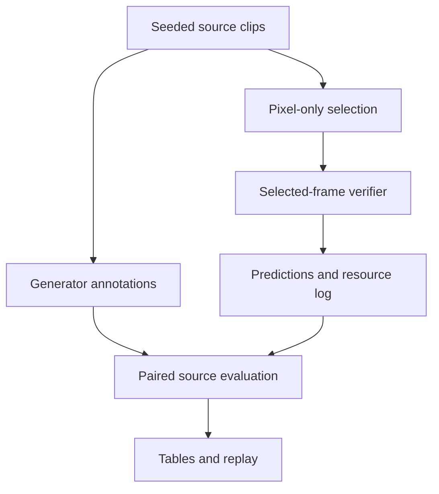

# BriefGuard

This experiment asks whether choosing frames by their visual content helps a video
checker catch short violations. It compares three samplers on synthetic clips using
the same pixel checker. Sampling an event and recognizing it are measured separately.
The timing includes each sampler's preprocessing.

At eight frames per clip, the simple change sampler has the highest observed recall.
The adaptive heuristic did not demonstrate an improvement over it. This is a small
CPU reference study; testing on natural generated videos is still pending.

Personal project of **Amir Asan**. Decisions, fixes and remaining
personal checks are recorded in the [development notes](docs/development_notes.md).

For a concrete starting point, follow the [two-case walkthrough in Russian](docs/walkthrough_ru.md)
and run `python scripts/explain_case.py`. It regenerates a clip, compares the
three methods with saved evidence, and recomputes their recall from the run rows.

The closest prior, [InfoShot/SynFlash](https://arxiv.org/abs/2603.17374), already
studies short synthetic anomalies. The [related-work table](docs/related_work.md)
compares twelve primary sources, checked on 2026-10-22. The contribution here is
the implemented experiment and its inspectable results.

## Results

For a new local clip, use the [workbench](docs/workbench.md): write requirements,
prepare selected frames and a request, then inspect a separately authorized model
response. Preparation is offline. This product workflow is separate from the
frozen experiment below; it supplies no new accuracy result by itself.

<!-- BEGIN GENERATED RESULTS -->
Held-out run `72b02803d9e0b835`: **32 source groups**, **832 clips** (768 violating, 64 clean), **7,488 recorded checks** across the prespecified budgets. Primary budget: **8 frames per clip**.

| Method | Violation recall | Event coverage (diagnostic) | Median CPU check time, including prepass |
|---|---:|---:|---:|
| uniform | 34.90% | 55.86% | 0.62 ms |
| change | 43.62% | 64.45% | 13.33 ms |
| adaptive | 41.54% | 60.94% | 19.27 ms |

Paired source-cluster bootstrap recall differences (percentage points, 95% intervals):

- `adaptive_minus_uniform`: **+6.64** [+2.99, +10.16].
- `adaptive_minus_change`: **-2.08** [-4.95, +0.65].

The prespecified hypothesis is **not supported**: an advantage over uniform selection alone is insufficient; it must also beat the simple change baseline.

Measured test execution: 41.16 s, peak process RSS 227.1 MiB, external API spend $0.00. These are recorded host observations, not cross-machine performance guarantees. Resource figures exclude environment installation and image illustration generation.

Every value above derives from `results/test/summary.json`, `metadata.json`, and the compressed predictions; regenerate this block with `python scripts/update_readme.py`.
<!-- END GENERATED RESULTS -->

The adaptive method costs more preprocessing time without a demonstrated recall
advantage over change sampling. One useful case to inspect is
`s010000-distractor-forbidden_patch-6`: the violation occupies frames [8,14), while
uniform selection takes frames 6 and 18 on either side and misses it.

Some subtle violations are deliberately below the pixel checker's tolerances. Even
selecting the right frame cannot make that checker recognize them. This known
limitation helps separate sampling failures from checker failures, but says nothing
about how a VLM would perform. See the [error analysis](docs/error_analysis.md).
No thresholds were tuned on the held-out results.

## Replay in seconds

[How to read the demo (Russian)](docs/demo_guide_ru.md) explains the timelines,
missed events and checker failures with two concrete cases.

Open `demo/index.html` in a browser after downloading the repository. It loads the bundled
`data.js` and local media without inference or an API key. Alternatively:

```bash
python3 -m http.server --bind 127.0.0.1 8765 --directory demo
# Open http://127.0.0.1:8765
```

The replay labels synthetic inputs, exact selected frame indices, per-method findings,
ground-truth intervals and actual misses. The integer frame timeline and lossless
PNG frames are authoritative. The gallery is explanatory and reveals the generator's
answers. For an actual blinded label audit, use the separate
[human-review package](docs/human_review.md); do not use the gallery as a blind test.
Human validation is **pending** until a person submits labels.

## Reproduce

Python **3.11+**; the recorded host used Python 3.12.14 on macOS/arm64. No GPU or paid service
is required. NumPy and Pillow are the only runtime dependencies.

```bash
python3 -m venv .venv
source .venv/bin/activate
python -m pip install -r requirements.txt
python -m unittest discover -s tests -v
python -m briefguard run --split test --out results/reproduce
python scripts/compare_runs.py results/test results/reproduce
```

Run these commands from the repository root. This is a source-checkout research
application; the Python wheel alone does not include the frozen study and demo assets.
The last command compares pixels, briefs, selections, predictions, labels and resources
exactly. Latency is machine dependent and is intentionally excluded from equality.
Run the same command again to resume: successful units are loaded from the atomic cache
or exported compressed evidence. Cached observations retain their original component timings.

To rebuild tables and the replay from recorded evidence:

```bash
python -m briefguard report --run results/test
python scripts/update_readme.py
python -m briefguard demo --run results/test --out demo
```

Study history: pilot → development inspection → config/code freeze commit → held-out test.
`configs/frozen.json` fixes the exact source IDs and hashes the analytical code and
protocol. A changed core source or configuration is rejected for the test run. To conduct
a different study, use an explicitly new protocol, split and freeze; do not overwrite this
study's lock. `make pilot`, `make dev`, `make freeze`, and `make experiment` expose the
original steps; `make freeze` intentionally refuses to overwrite the included freeze.

## Architecture



- `data.py`: original synthetic generator, public template briefs and separate annotations.
- `sampling.py`: three interchangeable strategies; all nonuniform preprocessing is accounted for.
- `verifier.py`: deterministic selected-pixel checker. It cannot receive a clip or its annotations.
- `video.py`: bounded NPZ, GIF and PNG-sequence normalization preserving source timing; no MP4 decoder is claimed.
- `runner.py` / `metrics.py`: immutable run identity, atomic cache/resume, raw responses,
  explicit denominators and paired source-cluster bootstrap intervals.
- `demo_export.py`: regenerates exact example clips and checks their pixel hashes.
- `vlm.py`: optional, separately gated Responses API adapter; **not used in reported results**.

## Evidence and limitations

| Artifact | Purpose |
|---|---|
| [Protocol](docs/protocol.md) | Primary hypothesis, decision rule, resource accounting, precision planning |
| [Frozen inputs](configs/frozen.json) | Pre-test code/config hashes and test sources |
| [Data card](docs/data_card.md) | Original generation process, privileges, intervals, provenance |
| [Results](results/test/tables.md) | All prespecified frame budgets and paired differences |
| [Predictions](results/test/predictions.jsonl.gz) | Every actual selected frame, response, label, pixel hash and timing |
| [Manifest](results/test/manifest.jsonl.gz) | Source grouping and per-clip identities |
| [Error analysis](docs/error_analysis.md) | Concrete misses and duration/type/severity slices |
| [Interview guide, Russian](docs/interview_ru.md) | Explain and defend the work without overstating it |
| [Development notes](docs/development_notes.md) | Decisions, fixes and pending personal review |
| [VLM follow-up](docs/vlm_pilot.md) | Explicit budget/model requirements for future real inference |
| [Verification record](docs/verification.md) | Independent artifact review, exact reproduction and remaining checks |
| [Security review status](docs/security_review.md) | Scoped source review and the incomplete formal scan |

The clean controls are easy and few; an observed zero false-alarm count is not a population
guarantee. Source siblings are dependent and are resampled together. This dataset's high
violation prevalence is artificial: approval contamination does not estimate deployment
risk. The static camera, known template regions, simple shapes and synthetic corruptions
limit generalization. There are no natural generated-video failures, independent human
labels, VLM experiments, confidence calibration or selective-risk guarantees in this run.
Real ad compliance remains unvalidated.

## Completion and follow-up

The [verification record](docs/verification.md) separates passed checks from checks
blocked by the execution environment. The original run and historical verification
record are retained; new evidence is recorded separately. The original task document
was available and checked against this continuation.

For a fresh machine, `PYTHON_BIN=python3.12 bash scripts/acceptance.sh` performs the
install, tests, reproduction and artifact checks and records the outcome. See the
[browser checklist](docs/browser_checklist.md) for the interactive checks that a
command-line success cannot establish.

The separate [VLM pilot protocol](docs/vlm_pilot.md) and
[natural-video protocol](docs/natural_video_pilot.md) are exploratory follow-ups.
They do not change the original hypothesis, frozen hashes or held-out results.
Live paid inference still requires Amir's explicit provider/model/budget approval;
human labels and personal code review require actual human participation.

## Separate host

For a CPU server, run the same commands with the same pinned dependencies and freeze.
The Dockerfile was built and its tests passed in the recorded owner-host acceptance
for commit `26d2118`; see [host evidence](results/verification_host/review.json).
A heavier VLM study needs a separately reviewed
model/budget and human-labeled data. Do not silently mix its results into this CPU study.

## License and attribution

MIT for the code and original procedural fixtures. The concept cover was generated with
ImageGen and is not used as research evidence. Cited papers and external datasets retain
their own terms; none of their videos or model weights are redistributed. This project is
independent and is not affiliated with Higgsfield or the cited authors.
